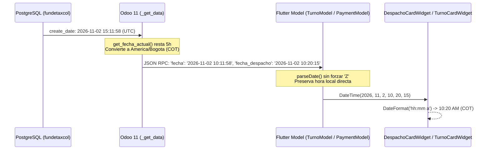

# 🏛️ Bitácora de Sesión: Calibración Canónica de Horas Odoo (COT) y Despliegue Multi-Dispositivo v2.1.20+22

**Fecha y Hora:** 02 de Noviembre de 2026 - 11:12:00 COT  
**Metodología:** Tripleta (OpenSpec + Implementación + Bitácora Dual + Engram)  
**Cambio OpenSpec:** `openspec/changes/calibracion-horas-despacho-odoo/`  
**Versión Final:** `v2.1.20+22`  
**Dispositivos Desplegados:** Teléfono Xiaomi (`6tl7gupn9tnjdapb`), Tablet Lenovo (`HA27VLYC`), PC Windows Desktop (`synergia_movil.exe`)

---

## 🎯 1. Contexto y Objetivos de la Sesión
El usuario reportó discrepancia horaria crítica en las tarjetas de la app móvil:
1. Las tarjetas de turnos mostraban `05:11 AM` y `05:23 AM` cuando el reloj físico del móvil y de Colombia marcaba las `10:25 AM`.
2. Las tarjetas de despachos mostraban la hora en que el vehículo llegó a la cola en vez de la hora en que fue despachado.
3. Se requería alineación completa con el comportamiento del sitio web (`fundetaxcol.co/tablero_turnos`), ejecutar la Tripleta completa con incremento de versión a `v2.1.20+22` y desplegar en teléfono, tablet y Windows.

---

## 🔬 2. Diagnóstico de Causa Raíz (Pila Completa DB $\leftrightarrow$ Odoo $\leftrightarrow$ Flutter)

1. **Inspección en Servidor Odoo 11 (`fundetaxcol.co`):**
   * En PostgreSQL, `fundetaxcol_turno.create_date` se almacena en UTC: `'2026-11-02 15:11:58'`.
   * En `/opt/synergia/addons_fundetaxcol/fundetaxcol/models/turno_model.py`:
     ```python
     'fecha': self.env['fundetaxcol.fundetaxcol'].get_fecha_actual(self.create_date)
     ```
   * `get_fecha_actual` calcula `diff = datetime.now(pytz.timezone('America/Bogota')).utcoffset()` (-5 horas) y entrega el string pre-convertido a hora local de Colombia: `'2026-11-02 10:11:58'`.
2. **Defecto en Flutter (Doble Conversión):**
   * En `lib/models/turno_model.dart` (`parseDate`) y `lib/models/payment_model.dart` (`parseOdooDateTime`), el código agregaba forzosamente `'Z'` al final del string (`'${str}Z'`) y llamaba `.toLocal()`.
   * Como Dart en Colombia opera con offset local -5, interpretaba que `'2026-11-02T10:11:58Z'` era hora UTC y le restaba 5 horas adicionales, arrojando `05:11:58 AM`.
3. **Omisión de `fecha_despacho`:**
   * `TurnoModel` omitía la deserialización de `json['fecha_despacho']`.
   * `DespachoCardWidget` formateaba `turno.fechaCreacion` (llegada a la cola) en vez de la hora real de salida al destino.

---

## 📐 3. Diagrama de Flujo de Datos Calibrado



---

## 🔄 4. Modificaciones de Código (Antes vs Después)

### A. `lib/models/turno_model.dart`
**ANTES:**
```dart
    DateTime parseDate(dynamic val) {
      if (val == null || val == false) return DateTime.now();
      var str = val.toString().trim();
      if (str.isEmpty) return DateTime.now();
      str = str.replaceFirst(' ', 'T');
      if (!str.endsWith('Z') && !str.contains('+') && !RegExp(r'-\d\d:?\d\d$').hasMatch(str)) {
        str = '${str}Z';
      }
      final dt = DateTime.tryParse(str);
      return dt != null ? dt.toLocal() : DateTime.now();
    }
```
**DESPUÉS:**
```dart
    DateTime parseDate(dynamic val) {
      if (val == null || val == false) return DateTime.now();
      var str = val.toString().trim();
      if (str.isEmpty) return DateTime.now();
      str = str.replaceFirst(' ', 'T');
      final dt = DateTime.tryParse(str);
      if (dt != null) {
        return dt.isUtc ? dt.toLocal() : dt;
      }
      return DateTime.now();
    }
```
*Y adición de `final DateTime? fechaDespacho;` con deserialización de `json['fecha_despacho']`.*

### B. `lib/models/payment_model.dart`
*Idéntica corrección en `parseOdooDateTime(dynamic raw)` para evitar restar 5 horas a los recibos de pago.*

### C. `lib/ui/widgets/despacho_card_widget.dart`
**ANTES:**
```dart
    final timeFormat = DateFormat('hh:mm a');
    final horaTexto = timeFormat.format(turno.fechaCreacion);
```
**DESPUÉS:**
```dart
    final timeFormat = DateFormat('hh:mm a');
    final fechaAMostrar = turno.fechaDespacho ?? turno.fechaCreacion;
    final horaTexto = timeFormat.format(fechaAMostrar);
```

### D. `lib/controllers/turno_controller.dart`
* Inclusión de `'fecha_despacho'` en el listado de campos del `searchRead` de respaldo.
* Asignación de `fechaDespacho: DateTime.now()` al momento de despachar localmente antes de sincronizar con el backend.

---

## 🛡️ 5. Gates de Verificación y Despliegue Físico

1. **Análisis Estático:**
   * `flutter analyze` $\rightarrow$ **0 issues found** (código 0).
2. **Pruebas Automatizadas:**
   * `flutter test` $\rightarrow$ **22 de 22 tests aprobados** (incluyendo prueba unitaria de calibración horaria COT y deserialización de `fecha_despacho`).
3. **Compilación de APK Release:**
   * `flutter build apk --release` $\rightarrow$ `build\app\outputs\flutter-apk\app-release.apk` (54.0 MB).
4. **Despliegue Teléfono Xiaomi (`6tl7gupn9tnjdapb`):**
   * Instalación completada (`Performing Streamed Install Success`).
   * `am start` ejecutado.
   * `dumpsys package` validado: `versionCode=22`, `versionName=2.1.20`, `lastUpdateTime=2026-11-02 11:09:24`.
5. **Despliegue Tablet Lenovo (`HA27VLYC`):**
   * Instalación completada (`Performing Streamed Install Success`).
   * `am start` ejecutado.
   * `dumpsys package` validado: `versionCode=22`, `versionName=2.1.20`, `lastUpdateTime=2026-11-02 11:09:47`.
6. **Compilación y Lanzamiento Windows Desktop (.EXE):**
   * Limpieza de binario previo ejecutada (FIX-001).
   * Compilación exitosa: `build\windows\x64\runner\Release\synergia_movil.exe` (91.136 bytes).
   * Mtime validado: `11/2/2026 11:11:15 AM`.
   * Proceso iniciado con PID `25808`.
7. **Registro de Aprendizaje en Mármol:**
   * Incorporado **FIX-012** en [`ERRORES.md`](file:///c:/Workspaces/synergia_movil/ERRORES.md).

