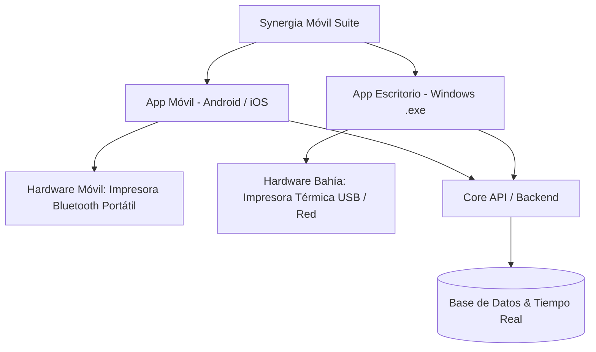

# 🚀 Synergia Móvil — Documento Maestro de Visión y Arquitectura

> **Marca de Producto:** Synergia Móvil  
> **Compañía Matriz:** Synergia Profesional SAS  
> **Fecha:** Octubre 2026  
> **Estado:** Fase de Concepción y Modernización Multiplataforma

---

## 1. 🎯 Visión del Producto

**Synergia Móvil** es una plataforma integral de movilidad, gestión de flotas, turnos de bahía y liquidación de pagos para el sector de transporte (taxis y vehículos de servicio público).

Nace tras 7 años de experiencia directa en el sector, evolucionando de una solución a medida para un único cliente hacia una **plataforma comercial independiente, modular y multi-empresa (SaaS / White-label)**.

---

## 2. 📱💻 Lo Mejor de los Dos Mundos: Multiplataforma Unificada

### A. App Móvil (Smartphones y Tablets)
* **Público objetivo:** Despachadores en calle, conductores y administradores en campo.
* **Características clave:**
  * Interfaz táctil ágil y optimizada para uso rápido en exteriores.
  * Impresión térmica portátil vía **Bluetooth (ESC/POS)** para emisión de tickets de turno y recibos de pago.
  * Gestión de turnos en tiempo real con alertas y notificaciones sonoras/push.
  * Modo offline parcial para captura rápida sin perder operaciones.

### B. App de Escritorio (Windows PC para Estaciones y Bahías)
* **Público objetivo:** Operadores de cabinas fijas de bahía, cajeros y administradores.
* **Características clave:**
  * Distribución nativa en Windows (.exe) de alto rendimiento.
  * Adaptabilidad a pantallas grandes (Monitores HD / Full HD), visualizando cuadrículas completas de turnos, tableros de control y colas de espera simultáneas.
  * Soporte de impresión térmica directa por **USB / Puerto Serie (COM) / Red LAN**.
  * Atajos de teclado para despacho y cobro ultrarrápido sin depender exclusivamente del mouse.

---

## 3. 🧩 Módulos y Funcionalidades del Sistema

### 1. Gestión de Bahías y Turnos
* **Apertura y Cierre de Sesión:** Control diario de caja y operatividad por cada bahía.
* **Secuencia de Turnos:** Ciclo completo: `Espera` ➔ `Actual` ➔ `Siguiente` ➔ `Despachado` ➔ `Pausa` / `Cancelado`.
* **Reglas de Despacho:** Asignación automática por orden de llegada, control de tiempos de espera y rotación equitativa.

### 2. Recaudos, Conceptos y Pagos
* **Cobro Integrado:** Liquidación de rodamiento, aportes, fondos de ahorro, seguros y conceptos variables.
* **Emisión Inmediata de Recibos:** Generación de recibo digital y físico con código de barras o QR para auditoría.
* **Opción "Pagar y Enturnar":** Flujo continuo de un solo clic que cobra el turno y lo posiciona en la cola automáticamente.

### 3. Maestros y Flota (Multi-Empresa)
* **Vehículos:** Control de placas, tipos, modelos, estado mecánico y documentos reglamentarios (SOAT, Técnico-Mecánica, Tarjeta de Operación).
* **Conductores:** Registro de licencia, vigencias, categoría, vinculación y créditos activos.
* **Empresas Asociadas:** Capacidad de operar múltiples empresas de taxi bajo una misma instalación de Synergia Móvil con datos aislados.

### 4. Hardware e Impresión Híbrida
* Abstracción de capa de impresión:
  * Si el entorno es móvil ➔ Escaneo y conexión Bluetooth automática.
  * Si el entorno es escritorio ➔ Envío directo al spooler de Windows o socket TCP directo a impresoras térmicas de 58mm/80mm.

---

## 4. 🛠️ Arquitectura Técnica y Estrategia de Código

### Frontend: Flutter 3 Multiplataforma (Dart)
* **Base de código única:** Un único repositorio Dart compilable para Android, iOS y Windows Desktop.
* **Identificador de paquete:** `com.synergia.movil`
* **Gestión de estado reactiva:** Migración y estabilización de controladores GetX a versiones compatibles con Flutter 3.x.
* **Desacoplamiento total de marca:** Eliminación de cualquier constante, nombre o dependencia hardcodeada a clientes específicos; parametrización completa vía configuración.

### Backend y Capa de Datos:
* **API RESTful de alto rendimiento:** Basada en FastAPI / Python o arquitectura Cloud con soporte para WebSockets / Socket.io para actualización en tiempo real de la cola de turnos.
* **Sincronización:** Arquitectura preparada para operar en la nube con capacidad de conector para ERPs contables cuando el cliente lo requiera.

---

## 5. 📋 Matriz de Prioridades de Implementación

| Fase | Tarea Principal | Resultado Esperado |
| :---: | :--- | :--- |
| **Fase 1** | **Rebranding y Renombrado del Núcleo** | Proyecto rebautizado como `Synergia Móvil`, package ID `com.synergia.movil`, limpieza de textos antiguos. |
| **Fase 2** | **Actualización del SDK a Flutter 3.x** | Resolución de dependencias (`get`, `intl`, eliminación de paquetes descontinuados como `js` y `archive`). |
| **Fase 3** | **Adaptabilidad Responsive Desktop** | Layouts responsivos que aprovechen el monitor de PC de escritorio y compilen como ejecutable Windows. |
| **Fase 4** | **Capa de Impresión Unificada** | Soporte tanto para Bluetooth térmico (móvil) como impresoras USB/Windows (escritorio). |
| **Fase 5** | **Conexión de Backend Central** | Consumo seguro y autenticado de la API central para turnos y pagos. |
